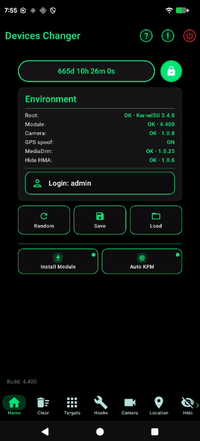
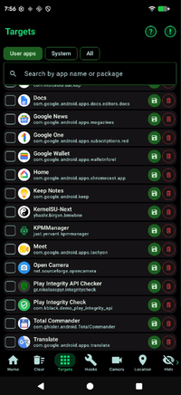
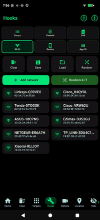
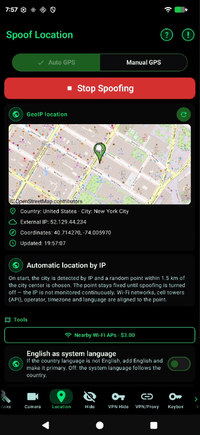

# Devices Changer

**Spoof identity, build, network, location, and environment on a rooted Android device**

Privacy · app testing · API checks against another phone

 

 

---

## Screenshots

<table>
  <tr>
    <td align="center"><a href="screenshots/home.png"> <b>Home</b></a></td>
    <td align="center"><a href="screenshots/targets.png"> <b>Targets</b></a></td>
    <td align="center"><a href="screenshots/hooks.png"> <b>Hooks</b></a></td>
    <td align="center"><a href="screenshots/location.png"> <b>Location</b></a></td>
  </tr>
</table>

## What it is

**Devices Changer** (`com.motorola.backup`) is a control panel for a rooted phone. It presents a chosen device, network, and location to apps and to the system, so you can test software or keep a consistent identity.

It needs **Android 11+**, **root** (Magisk or KernelSU), and **Zygisk**. An access code from the [bot](https://t.me/DeviceChanger_bot) or the [site](https://deviceschanger.org) unlocks the tools. Current build: **4.400** (1770).

## What it can do

- **Identifiers** — Android ID, GSF ID, IMEI, Wi-Fi and Bluetooth addresses, advertising ID, Media DRM, SIM data
- **Device profile** — model, brand, fingerprint, kernel, user agent, and the rest of the build
- **SIM and cell** — operator, signal, slots, synthetic towers
- **Wi-Fi** — saved networks, scan results, the current network
- **Location** — coordinates, satellites, and related sensors
- **Per app** — a separate hook set and IDs for selected packages
- **Hide** — hide installed apps from chosen targets
- **VPN** — hide a VPN from apps, or run your own tunnel
- **Camera** — replace the camera picture with a file or a stream
- **Browser** — a fingerprint profile for the companion browser
- **Keybox** — attestation keybox, with TEESimulator and Play Integrity Fix
- **Cleanup and backup** — local cleanup, and a cloud backup of profiles and settings

A home-screen widget shows the profile, modules, root, license, and network status.

---

Use it on your own device, for privacy and testing. You are responsible for how you use it.
