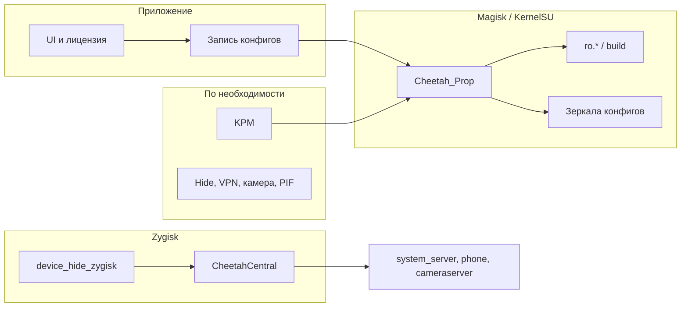

<div align="center">

# Devices Changer

**Управляемая подмена идентификаторов, сборки, сети, локации и окружения на rooted Android**

Приватность · тестирование приложений · отладка API под другим устройством

<br>

[](update.json)
[](https://developer.android.com)
[]()
[]()

<br>

[](https://deviceschanger.org)
[](https://t.me/DeviceChanger)
[](https://t.me/DeviceChanger_bot)
[](https://github.com/Spayder666/DeviceChanger/tree/main/DeviceProfile)

</div>

---

## О проекте

Один APK — панель управления. Подмена собирается из модуля **Cheetah_Prop**, Zygisk-модуля **Device Hide** с центральным слоем **CheetahCentral** и, по необходимости, KPM. Отдельный менеджер LSPosed и его scope в установку не входят.

| | |
| --- | --- |
| **Пакет** | `com.motorola.backup` |
| **Имя в лаунчере** | Devices Changer |
| **Модуль Magisk / KernelSU** | **Cheetah_Prop** → `/data/adb/modules/Cheetah_Prop` |
| **Zygisk-модуль** | **Device Hide** (`device_hide_zygisk`) — CheetahCentral, `engine.dex` |
| **Версия приложения** | **4.400** (code **1770**) |
| **Опубликованный APK** | [`update.json`](update.json) — его читает проверка обновлений в приложении |
| **minSdk** | 30 (Android 11) |
| **targetSdk** | 35 |
| **compileSdk** | 36 |
| **Языки UI** | English · Русский · 简体中文 |

---

## Содержание

- [Как это устроено](#как-это-устроено)
- [Требования](#требования)
- [Быстрый старт](#быстрый-старт)
- [Карта интерфейса](#карта-интерфейса)
- [Функции](#функции)
- [Help и Advanced](#help)
- [Конфиги и пути](#конфиги-и-пути)
- [Отладка](#отладка)
- [Предупреждение](#предупреждение)

---

## Как это устроено

Без нужного слоя часть значений видна только в одном месте: `getprop` и настройки телефона, приложение из списка Targets и системный процесс читают разные источники.



| Слой | Что делает |
| --- | --- |
| **Приложение** | UI, лицензия, запись конфигов, установка Cheetah_Prop и дополнительных модулей |
| **Cheetah_Prop** | `post-fs-data` / `service.sh`: resetprop сборки и SIM, зеркала конфигов, `device.kernel`, автозагрузка KPM. После обновления APK на следующей загрузке подтягивает актуальный `engine.dex` |
| **Device Hide Zygisk** | Грузит **CheetahCentral** в системные процессы: идентичность, телефония, GPS/SIM. Та же вкладка **Hide** прячет список приложений |
| **Targets** | Пакеты, которым нужен дополнительный per-app слой (`per_app_hooks.json`, список для нативного SoC / getprop) |
| **KPM** | По флажкам в Help: карты и пути, TUN, `uname`, getprop для приложений, SELinux и netlink |
| **Остальные ZIP** | MediaDrm, VPN Hide, камера StreamDC, Play Integrity Fix, TEESimulator, ReZygisk, BRENE |

`system_server` не читает `/data/local/tmp`: на строгих прошивках это `shell_data_file` и отказ SELinux. GPS и часть XML для системных процессов лежат в каталоге модуля и в `/data/system`.

На KernelSU скрытие `/data/adb` ломает чтение зеркал из приложений. Конфиги поэтому дублируются в модуль и в публичный каталог `/storage/emulated/0/Cheetah_Prop_public`.

---

## Требования

| | |
| --- | --- |
| Root | Magisk, KernelSU или совместимый менеджер. При первом запуске приложению нужен root |
| Zygisk | Включён в Magisk, либо **ReZygisk** из Help → Install Module |
| Модули | **Cheetah_Prop** ставится приложением сам. **Device Hide Zygisk** — из Help → Install Module, затем перезагрузка |
| Android | 11 и новее (API 30+) |
| Лицензия | Код с [@DeviceChanger_bot](https://t.me/DeviceChanger_bot) или [deviceschanger.org](https://deviceschanger.org). Без активного кода видны только **Home** и **Help** |
| KPM | Нужен KPatch / APatch, если включаете автозагрузку в Help. В boot image модули не вшивать |

Два модуля не должны писать одни и те же `ro.*`. Чужой спуфер сборки рядом с Cheetah_Prop даёт смешанный отпечаток.

---

## Быстрый старт

### 1. Поставить APK

Сборка с сайта или проверка обновлений в приложении (`update.json`). При первом запуске с root приложение само ставит или обновляет **Cheetah_Prop**.

### 2. Включить Zygisk и Device Hide

1. В менеджере root включите **Zygisk** (или поставьте ReZygisk из приложения).
2. **Help → Install Module** → **Device Hide Zygisk**.
3. Перезагрузите устройство.

После обновления APK тоже нужна перезагрузка: живой `engine.dex` обновляется скриптом модуля на boot, а не в момент `adb install`.

### 3. Активировать лицензию

На **Home** — замок и поле кода. По истечении срока остаются **Home** и **Help**.

### 4. Базовый сценарий «другое устройство»

| Шаг | Действие |
| --- | --- |
| 1 | **Hooks → Device** — загрузить профили, включить Spoof, выбрать профиль, перезагрузить |
| 2 | **Hooks → FakerId** — включить нужные ID, Generate / Save |
| 3 | **Hooks → SIM / Wi‑Fi** и **Location** — оператор, вышки, сети, GPS |
| 4 | **Targets** — отметить приложения, которым нужен per-app набор |
| 5 | **Help → Advanced** — KPM, BRENE, PIF и соседние ZIP только если они нужны |

Виджеты рабочего стола **Status 4×2** и **Status 4×1** показывают профиль, модули, KPM, root, лицензию и сеть. После загрузки они перепроверяют KPM и свойства, пока те не устаканятся.

---

## Карта интерфейса

Нижняя карусель. Без лицензии видны только **Home** и **Help**.

| Вкладка | Зачем |
| --- | --- |
| **Home** | Среда (root, Cheetah, Zygisk, GPS, MediaDrm, VPN), лицензия, перезагрузка, облако |
| **Clear** | Локальная очистка с предпросмотром: кэш, данные браузера, сброс выбранных целей |
| **Targets** | Per-app политика хуков |
| **Hooks** | Status, FakerId, SIM, Wi‑Fi, Device, App ID |
| **Camera** | StreamDC: подмена кадра (файл или RTMP) |
| **Location** | GPS, вышки, спутники, датчики |
| **Hide** | Скрытие списка приложений |
| **VPN Hide** | Скрытие VPN/TUN от выбранных приложений |
| **VPN/Proxy** | Свой туннель или прокси |
| **Keybox** | TEESimulator, Play Integrity Fix, keybox и сверка с профилем |
| **Backup** | Облачные бэкапы профилей и настроек |
| **Finger** | Профили отпечатка для браузера |
| **Help** | Язык, обновления, Telegram, Advanced |

С **Home** также открываются **System Info** и сводка окружения.

---

## Функции

<details>
<summary><strong>Home</strong></summary>

- Индикаторы: root, Cheetah_Prop, Zygisk / Device Hide, GPS, MediaDrm, VPN Hide, камера, TEESimulator, Play Integrity Fix
- Лицензия: логин, оставшееся время, ввод кода
- Перезагрузка с подтверждением
- Проверка обновлений APK
- При активной лицензии — переходы в разделы и облако

</details>

<details>
<summary><strong>Hooks → Status</strong></summary>

Мастер-переключатель спуфа, целевая страна (MCC/MNC для SIM и локали), USB / developer hide, карточка батареи.

**Target country** подтягивает оператора и связанные настройки под выбранную страну.

</details>

<details>
<summary><strong>Hooks → FakerId</strong></summary>

Поштучные идентификаторы. У карточки — значение, тумблер и генерация.

Типичный набор:

- Android ID, GSF ID, Google Advertising ID, Media DRM ID
- Hardware serial
- IMEI / MEID (SIM 1 и 2), IMSI / ICCID, SIM serial, Sub ID, номер
- Bluetooth MAC
- Locale и часовой пояс

Пачкой: Select all, Cancel all, Random all, Clear, Save / Load.

**Save** пишет конфиг в модуль и зеркала. Свойства, которые читают `system_server` или init, применяются после **перезагрузки**.

</details>

<details>
<summary><strong>Hooks → SIM</strong></summary>

Состояние SIM, число слотов, оператор и carrier id, CellInfo (скрытие или синтетические вышки), сигнал, roaming и тип сети.

Вышки можно отдать и без живой сотовой сети. Сохраните настройки: чекеры читают записанный XML, а не черновик на экране.

</details>

<details>
<summary><strong>Hooks → Wi‑Fi</strong></summary>

Список сетей (SSID, BSSID и доп. поля), ручное добавление, генерация нескольких случайных, правка и удаление. Скан и текущая сеть подменяются, если включены соответствующие тумблеры.

Опционально панель Wigle — привязка сетей к местности.

</details>

<details>
<summary><strong>Hooks → Device</strong></summary>

Профили `.prop`: модель, brand, manufacturer, fingerprint, id, tags, kernel, user agent, vendor и набор Build.*.

Источник загрузки — [`DeviceProfile`](https://github.com/Spayder666/DeviceChanger/tree/main/DeviceProfile) в этом репозитории. Часть профилей уже вшита в APK.

1. Включить **Spoof**
2. Выбрать профиль
3. Перезагрузить

**Kernel release.** Java-слой закрывает `System.getProperty("os.version")`, shell `uname -r` и `Os.uname()`. Системный вызов `uname` этим слоем не перехватывается. Если отчёт показывает два разных release, включите **Cheetah UnameHide** в Help → KPM auto loader (нужен KPatch). Модуль читает `/data/adb/modules/Cheetah_Prop/device.kernel`.

</details>

<details>
<summary><strong>Hooks → App ID</strong></summary>

Свои идентификаторы на конкретный пакет, когда общий Faker ID ломает один клиент. Импорт и поиск установленных приложений.

</details>

<details>
<summary><strong>Targets</strong></summary>

Глобальный набор плюс исключения на пакет: телефония, Wi‑Fi, ID, Build, GPS/GNSS, BLE, сенсоры, web fingerprint, USB, батарея и соседние переключатели из того же списка.

Политика пишется в `per_app_hooks.json` (модуль и зеркала). Отмеченные пакеты попадают в список нативного слоя. Само приложение `com.motorola.backup` хуки на себя не вешает.

Координаторы в `system_server`, phone и cameraserver этой вкладкой по одному не выключаются.

</details>

<details>
<summary><strong>Location</strong></summary>

- **Auto Spoof GPS** — город по IP, сдвиг порядка километра, лёгкое движение
- Ручные координаты (карта или ввод)
- Высота и точность
- Спутники и созвездия, барометр и движение
- Китайские карты (GCJ-02)
- BLE: блок скана или синтетические маяки при включённом GPS spoof
- Скрытие mock location

Координаты для `system_server` лежат в каталоге модуля и `/data/system`, не в tmp. После смены точки перезапустите клиент карт; для системного процесса — перезагрузка.

</details>

<details>
<summary><strong>Clear</strong></summary>

Локальный очиститель с предпросмотром и проверкой по каждой цели. Безопасные категории кэша не сбрасывают аккаунты и сессии. Сброс данных — отдельная группа, её видно до запуска.

</details>

<details>
<summary><strong>Hide · VPN · Camera · Finger · Keybox · Backup</strong></summary>

**Hide** — шаблоны (root, детекторы и похожие списки), приложения, логи. Нужен установленный **Device Hide Zygisk** и перезагрузка.

**VPN Hide** — какие приложения не должны видеть интерфейс и сокеты VPN. Zygisk ZIP и при необходимости Ports ZIP.

**VPN/Proxy** — свой туннель. При активном туннеле локальные ICE-адреса можно скрыть.

`vpnhide.kpm` приложение не экспортирует: вшивка в boot несёт риск bootloop. Для TUN на уровне ядра — **cheetah_tunhide**, только Install/Load, не Embed.

**Camera** — подмена кадра из файла или RTMP (StreamDC). Модуль ставится из Advanced.

**Finger** — профили браузера: легенда, профиль устройства или ручные поля. Один и тот же seed даёт стабильный отпечаток. Обновление браузера — [`updatebrowser.json`](updatebrowser.json).

**Keybox** — keybox, TEESimulator, Play Integrity Fix и сверка с выбранным профилем устройства. Индикаторы на экране — локальная диагностика. Итоговый ответ Google смотрит внешний чекер. После смены keybox, отпечатка PIF или профиля сохраните изменения и перезагрузитесь, если приложение об этом просит.

**Backup** — облачный бэкап и восстановление (аккаунт на Home).

**System Info** — снимок «что задано» и «что видно сейчас».

</details>

---

## Help

- Язык интерфейса
- Канал, бот, сайт
- Проверка обновления APK

### Advanced

**Install Module.** Cheetah_Prop приложение ставит само при старте. Остальное — по выбору:

| Модуль | Назначение |
| --- | --- |
| Device Hide Zygisk | CheetahCentral и скрытие списка приложений |
| MediaDrm Zygisk | Native DRM id |
| VPN Hide Zygisk | Скрытие VPN |
| VPN Hide Ports | Дополнительные порты |
| Play Integrity Fix | Отпечаток для проверки целостности |
| TEESimulator | Стек аттестации вместе с вкладкой Keybox |
| ReZygisk | Zygisk, если в менеджере root его нет |
| BRENE | SuSFS на KernelSU; патч имеет смысл только при уже установленном модуле `brene` |
| KPatch-Next | Загрузчик KPM |

**Export all KPM** кладёт файлы в `Downloads/kpm`. Дальше вручную: KPatch → KPModule → Install или Load. **Embed в boot из приложения не делать.**

**KPM auto loader** — отложенная загрузка после boot. Подождите 1–2 минуты после перезагрузки. Флаги:

| Модуль | Назначение |
| --- | --- |
| Cheetah SusMap | Скрытие карт и путей. Только Load |
| Cheetah TunHide | Скрытие TUN. Только Install/Load |
| Cheetah Selenf | Запросы SELinux |
| Cheetah NlDump | Netlink |
| Cheetah UnameHide | Native `uname()` — kernel release |
| Cheetah ExecShim | Ответы `getprop` для приложений |

Общий переключатель **Enable after reboot** включает загрузчик. Снятие модуля с boot image остаётся ручным откатом через recovery, если загрузка ядра не стартует.

---

## Конфиги и пути

Главный XML — **FakerIdPrefs.xml**. Приложение пишет его в модуль, затем в зеркала. Корень `/sdcard/FakerIdPrefs.xml` не используется.

| Назначение | Основной путь | Зеркала |
| --- | --- | --- |
| Faker prefs | `/data/adb/modules/Cheetah_Prop/FakerIdPrefs.xml` | `/storage/emulated/0/Cheetah_Prop_public/`, `/data/local/tmp/FakerIdPrefs.xml` (не для `system_server`) |
| Per-app хуки | `…/Cheetah_Prop/per_app_hooks.json` | public и tmp |
| GPS | `…/Cheetah_Prop/gps_coords.txt`, `gps_satellites.txt` | `/data/system` для системного процесса; public / tmp — для приложений |
| Wi‑Fi и вышки | `wifi_networks.json`, `cell_towers.json` в модуле | tmp |
| Профиль устройства | `spoof.devices.enabled`, `spoof.devices.selected.profile` | |
| Kernel release для KPM | `…/Cheetah_Prop/device.kernel` | `/data/local/tmp/device.kernel` |
| Лицензия | `/data/misc/device_license.dat` | переживает удаление приложения |
| Очистка | `…/Cheetah_Prop/clear/` | только внутри модуля, наружу не зеркалится |

---

## Отладка

```bash
adb logcat | findstr /I cheetah
adb shell getprop | findstr /I "build device manufacturer"
```

На устройстве конфиг:

```bash
adb shell su -c "cat /data/adb/modules/Cheetah_Prop/FakerIdPrefs.xml"
```

| Симптом | Что проверить |
| --- | --- |
| Сборка и ID остались хостовыми | Cheetah_Prop установлен, Zygisk включён, Device Hide стоит, была перезагрузка, мастер-спуф и тумблер поля включены |
| Два разных kernel release | UnameHide не загружен или пустой `device.kernel`. После boot подождите минуту-две |
| Профили не грузятся | Сеть и доступ к `DeviceProfile` в этом репозитории |
| GPS виден только части приложений | Координаты сохранены, клиент перезапущен; для системы — файл в модуле и перезагрузка |
| Спутники моргают после обновления APK | Не было перезагрузки: старый `engine.dex` ещё в живом модуле |
| Приложение почти пустое | Истекла лицензия: открыты только Home и Help |

---

## Предупреждение

Инструмент для своего устройства, отладки и приватности. Обход чужих защит, мошенничество и нарушение закона остаются на стороне пользователя. Автор не отвечает за такое использование.

---

<div align="center">

**Последнее обновление README:** 2026-10-18

</div>
